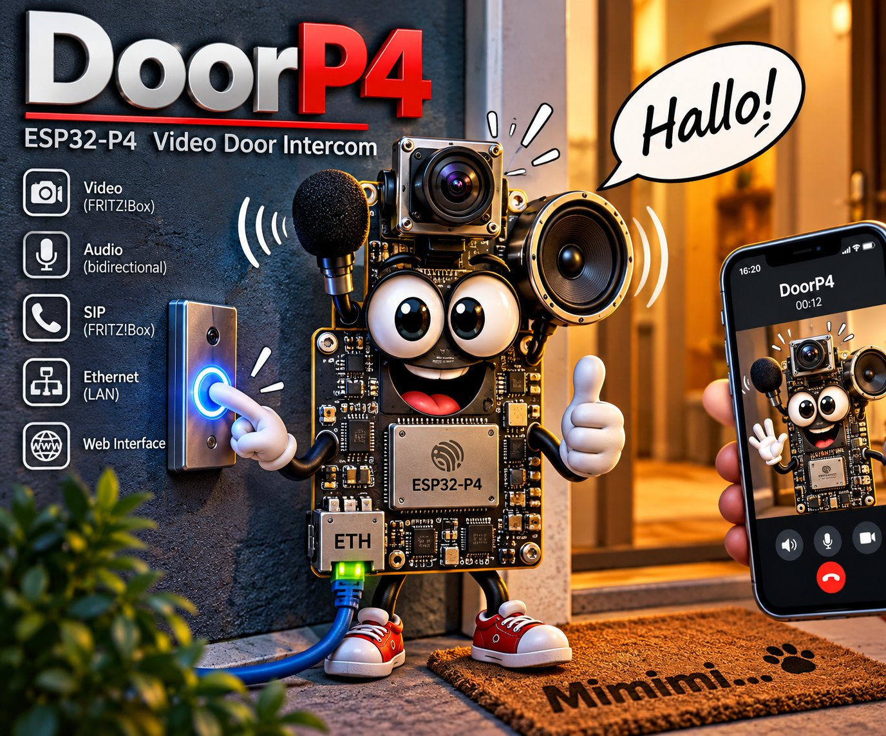
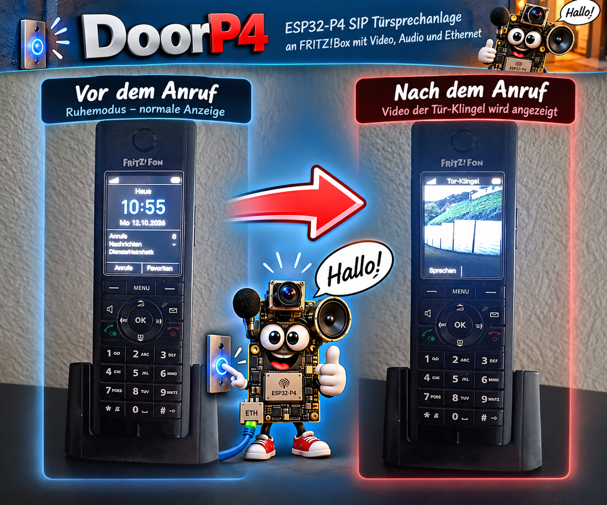
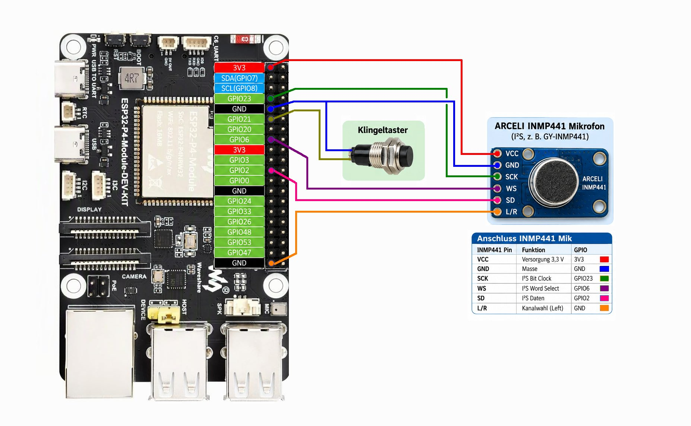
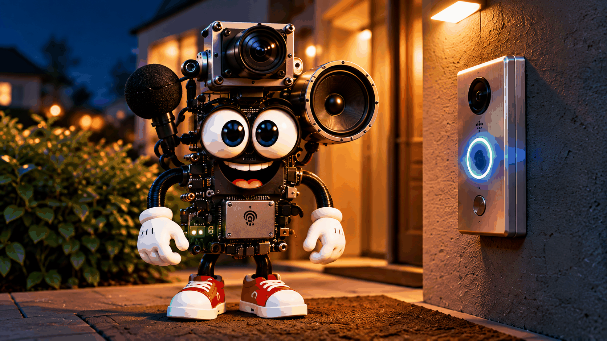

# DoorP4 – ESP32-P4 Video SIP Door Intercom
DoorP4 is an open-source ESP32-P4 SIP door intercom for the AVM FRITZ!Box, built with PlatformIO/Arduino, Ethernet and bidirectional G.711 audio.

**Current release V1.02a provides SIP audio. Video support is planned using an external IP camera integrated via the FRITZ!Box. The ESP32-P4 camera interface is currently not used and can be added as an optional extension.**

DoorP4 is an experimental SIP door intercom based on the ESP32-P4.

## Current status

The current version **V1.02a** provides:

- Ethernet connectivity
- SIP registration with a FRITZ!Box
- Doorbell button handling
- SIP call setup
- Bidirectional audio
- INMP441 microphone input
- ES8311 audio output
- G.711 A-law (PCMA) audio over RTP
- Simple web interface

## Camera Support

DoorP4 can use an existing external IP camera through the FRITZ!Box.

If you already have an IP camera running on your network, you can use it to display camera images on your FRITZ!Fon when someone rings the doorbell. **No modifications to the DoorP4 source code are required.**

To configure this, open the FRITZ!Box web interface:

**Telephony → Telephony Devices → Edit Door Intercom → Live Image**

Enter the image URL provided by your IP camera (for example, `http://192.168.1.100/snapshot.jpg`). The camera must provide an image format supported by the FRITZ!Box.

For detailed setup instructions, see the official AVM guide:

**[AVM – Setting up an IP door intercom in the FRITZ!Box](https://at.fritz.com/service/wissensdatenbank/dok/FRITZ-Box-7590/3513_IP-Tursprechanlage-in-FRITZ-Box-einrichten/)**

The camera image shown in the screenshots below comes from an existing external IP camera configured this way.

Alternatively, the ESP32-P4's own camera interface could be used. **This option is not yet implemented in DoorP4**, but the hardware provides the necessary interface for a future extension.

## Hardware

Current development platform:

- Waveshare ESP32-P4 Module-DEV-KIT
- INMP441 microphone
- ES8311 audio codec / speaker output
- Ethernet connection

Detailed FRITZ!Box setup guide: See [DoorP4_FRITZBox_Configuration.pdf](DoorP4_FRITZBox_Configuration.pdf) for the complete step-by-step configuration with screenshots.

## Project status

DoorP4 is already running as a functional SIP door intercom with bidirectional audio.

This is the first public version of the project. Documentation, configuration instructions, hardware details and further development will follow.

More to come.
